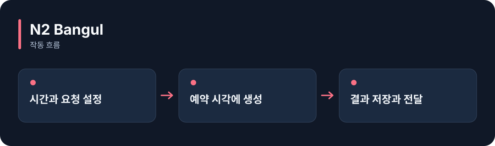

# N2 Bangul

**정해 둔 시간에 AI에게 글을 요청하고, 답변과 전달 결과를 기록합니다.**

[](https://github.com/choihyunsus/n2-bangul/releases/tag/v1.0.0) [](https://github.com/choihyunsus/n2-bangul/blob/main/docs/reference.ko.md) [](https://github.com/choihyunsus/n2-bangul/blob/main/LICENSE)

[English](README.md)



## 이런 때 사용하세요

매일 아침 계획 질문을 받거나, 정해진 간격으로 요약 문구를 만드는 기능에 활용하세요. 요약할 자료는 앱에서 제공해야 합니다.

예약이 실행되려면 프로세스가 켜져 있어야 합니다. 모델 제공자와 전달 대상을 등록하며, 결과는 기본 기록 외에 설정한 웹훅으로 전달할 수 있습니다.

## 처음 실행하기

터미널에서 `node --version`을 실행해 Node.js 22 이상인지 확인하세요. 아래 명령은 새 연습 폴더를 만들고 GitHub 배포 파일을 설치합니다. 예제 파일과 DB도 이 폴더에 두면 경로를 따라가기 쉽습니다.

```sh
mkdir n2-bangul-demo
cd n2-bangul-demo
npm init -y
npm install https://github.com/choihyunsus/n2-bangul/releases/download/v1.0.0/n2-bangul-1.0.0.tgz
```

설치 중 SQLite 빌드 오류가 나오면 운영체제에 맞는 C/C++ 빌드 도구가 필요할 수 있습니다. 자세한 환경 조건은 [설치 참고](https://github.com/choihyunsus/n2-bangul/blob/main/docs/reference.ko.md)에 있습니다.

아래 내용을 `demo.mjs`로 저장하세요. 파일은 방금 설치 명령을 실행한 폴더에 둡니다.

먼저 Ollama를 실행하고 터미널에서 `ollama list`로 설치된 모델 이름을 확인하세요. 코드의 `YOUR_INSTALLED_MODEL`을 그 이름으로 바꿉니다. 모델이 설치되어 있어야 하며, 답변은 모델마다 달라집니다.

```js
import { Bangul, ollamaChat } from 'n2-bangul';
const scheduler = new Bangul({
  dbPath: './demo.db', project: 'demo', agent: 'assistant',
  provider: ollamaChat({ id: 'local', model: 'YOUR_INSTALLED_MODEL', think: false }),
});
try {
  const job = scheduler.get('daily-note') ?? scheduler.create({
    name: 'Daily planning question', schedule_type: 'cron', schedule_value: '0 9 * * *',
    time_zone: 'Asia/Seoul', user_message: 'Write one short question to help plan my day.',
    max_output_tokens: 128,
  }, 'daily-note');
  const result = await scheduler.trigger(job.id, 'preview-1');
  console.log(result.status, result.content);
} finally {
  await scheduler.close();
}
```

```sh
node demo.mjs
```

성공하면 `success`와 계획 질문이 출력됩니다. 이 예제는 예약을 등록하고 한 번 즉시 미리 실행합니다. 실제 예약 실행은 앱을 켜 둔 채 `start()`를 호출해야 합니다.

## Soul과 함께 쓰기

여러 N2 모듈을 연결할 때 같은 `mimir.db` 파일을 지정하세요. `project`는 작업 이름, `agent`는 계속 사용할 AI 이름입니다. 같은 작업의 기록을 이어 쓰려면 이 값들을 맞춥니다. 단독 사용도 같은 필드 구조를 사용합니다.

## 다음 단계와 상세 안내

[전체 사용 안내](https://github.com/choihyunsus/n2-bangul/blob/main/docs/reference.ko.md)에서 실제 앱 연결, API, 지원 범위, 복구 절차와 검증 범위를 확인할 수 있습니다. [배포 파일](https://github.com/choihyunsus/n2-bangul/releases/tag/v1.0.0)에는 설치할 버전과 변경 설명이 있습니다.

처음 나오는 용어는 이렇게 읽으면 됩니다. **MCP**는 AI 앱의 도구 연결 방식, **DB**는 저장 파일, **호스트**는 이 모듈을 연결해 실행하는 앱입니다.

사용·재배포 조건은 [라이선스](https://github.com/choihyunsus/n2-bangul/blob/main/LICENSE)를 확인하세요. 의존 모듈에는 별도 조건이 적용될 수 있으며, 상업 이용 조건은 상세 안내에 함께 설명되어 있습니다.
