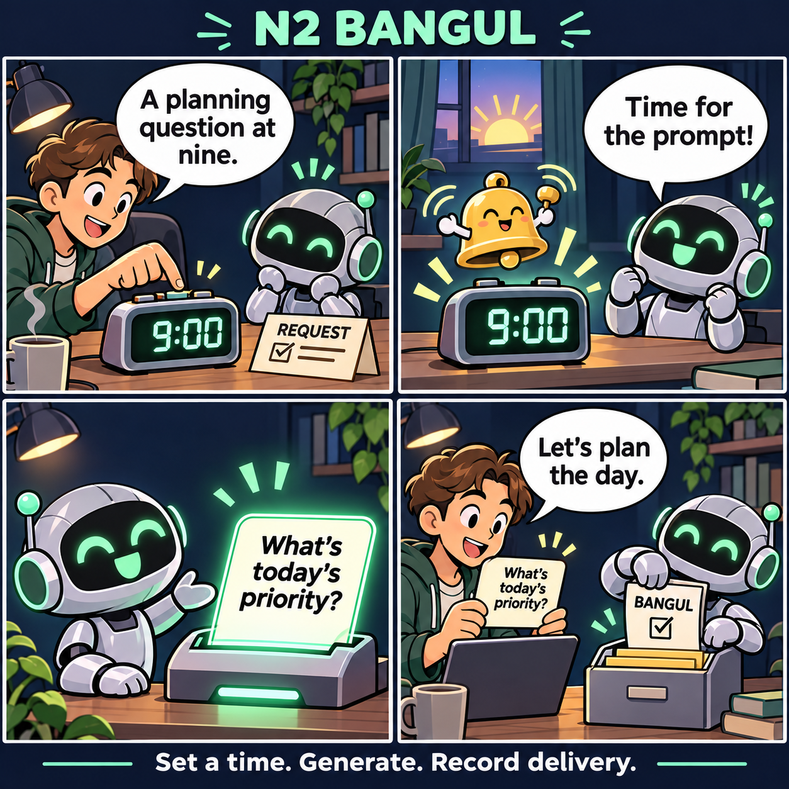
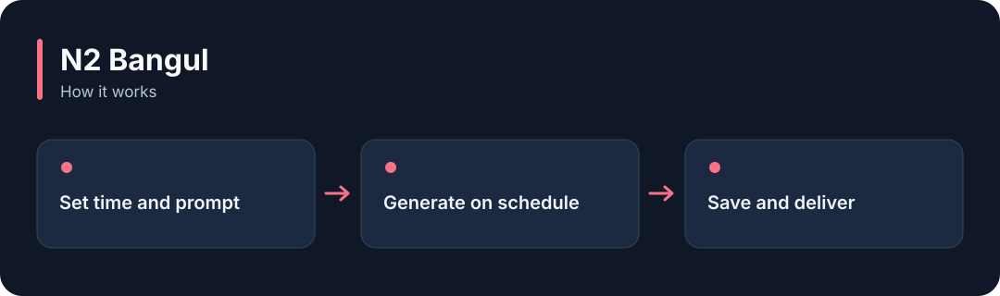

# N2 Bangul

**Ask an AI for a text response on a schedule, and record the reply and its delivery.**

[](https://github.com/choihyunsus/n2-bangul/releases/tag/v1.0.0) [](https://github.com/choihyunsus/n2-bangul/blob/main/docs/reference.md) [](https://github.com/choihyunsus/n2-bangul/blob/main/LICENSE)

[한국어](README.ko.md)

<p align="center">
  
</p>

Ask an AI for a text response on a schedule, and record the reply and its delivery.

A story illustrating the feature, rather than a screenshot of the app.

<details>
<summary>View the workflow</summary>



</details>

## When to use it

Generate a daily planning question or a recurring summary message. Your app must supply the material to summarize.

Keep the process running for scheduled execution. Register the model provider and delivery targets. Results can also go to a configured webhook.

## Try it

Run `node --version` in a terminal and check for Node.js 22 or later. These commands create a fresh practice folder and install the GitHub release. Keep the example file and database in this folder.

```sh
mkdir n2-bangul-demo
cd n2-bangul-demo
npm init -y
npm install https://github.com/choihyunsus/n2-bangul/releases/download/v1.0.0/n2-bangul-1.0.0.tgz
```

If installation reports a SQLite build error, you may need your platform’s C/C++ build tools. See the [installation reference](https://github.com/choihyunsus/n2-bangul/blob/main/docs/reference.md) for platform requirements.

Save the following as `demo.mjs` in the folder where you ran the install command.

Start Ollama and run `ollama list` to see your installed models. Replace `YOUR_INSTALLED_MODEL` with one of those names. A model must already be installed, and replies vary by model.

```js
import { Bangul, ollamaChat } from 'n2-bangul';
const scheduler = new Bangul({
  dbPath: './demo.db', project: 'demo', agent: 'assistant',
  provider: ollamaChat({ id: 'local', model: 'YOUR_INSTALLED_MODEL', think: false }),
});
try {
  const job = scheduler.get('daily-note') ?? scheduler.create({
    name: 'Daily planning question', schedule_type: 'cron', schedule_value: '0 9 * * *',
    time_zone: 'Asia/Seoul', user_message: 'Write one short question to help plan my day.',
    max_output_tokens: 128,
  }, 'daily-note');
  const result = await scheduler.trigger(job.id, 'preview-1');
  console.log(result.status, result.content);
} finally {
  await scheduler.close();
}
```

```sh
node demo.mjs
```

On success, `success` and a planning question appear. This registers a schedule and runs one immediate preview. Keep the app running and call `start()` for timed execution.

## Using it with Soul

Point connected N2 modules at the same `mimir.db` file. `project` names the work and `agent` names the AI identity you will keep using. Match those values to continue working with the same records. Standalone use follows the same field layout.

## Next steps and reference

The [full reference](https://github.com/choihyunsus/n2-bangul/blob/main/docs/reference.md) covers app integration, APIs, supported features, recovery and validation. The [release page](https://github.com/choihyunsus/n2-bangul/releases/tag/v1.0.0) contains the installable version and release notes.

A few terms used in the reference: **MCP** connects tools to an AI app, a **database** stores records, and the **host** is the app that connects and runs this module.

Review the [license](https://github.com/choihyunsus/n2-bangul/blob/main/LICENSE) for use and redistribution. Dependencies can have their own terms, including commercial-use conditions described in the reference.
